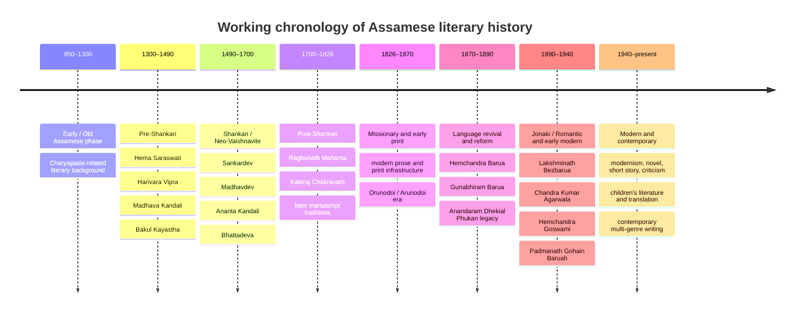

# Assamese Literary Personalities A–Z: Research Corpus, Dataset, and Verification Report

## Executive summary

This research release compiles a **225-person A–Z working corpus of Assamese literary personalities**, ranging from medieval and early Assamese writers through the nineteenth-century language revival, the Jonaki generation, twentieth-century modernism, post-independence fiction and criticism, children's literature, translation, and writers recognized through 2025. The corpus deliberately combines canonical figures with translators, critics, children's authors, scholars, periodical writers, award recipients, and lesser-documented personalities who are much harder to discover through ordinary English-language searches.

The downloadable files are:

**[Download the full CSV — 225 personalities](sandbox:/mnt/data/assamese_literary_personalities_AZ_2026-10-07.csv)**  
**[Download the full Excel workbook — 225 personalities + source register + verification queue](sandbox:/mnt/data/assamese_literary_personalities_AZ_2026-10-07.xlsx)**  
**[Download the genre visualization](sandbox:/mnt/data/assamese_literary_primary_genres_2026-10-07.png)**

The Excel version is the more useful research artifact. It contains six worksheets: **Personalities**, **Summary**, **Genre Counts**, **Data Dictionary**, **Source Register**, and **Verification Queue**. The main sheet has 20 fields, including every column requested: canonical name, alternate/pen names, life dates, birthplace, region, gender, writing language, genres, works and dates, publishers/venues, biography, awards, affiliations, source links, Wikipedia status, and source confidence.

Of the 225 records, **115 have an English Wikipedia biography that was positively located in this research pass; 110 did not have an English biography located in the surveyed categories and searches**. “No” therefore means **“no English Wikipedia article located in this survey”**, not “proved absent from every language edition of Wikipedia.” That distinction matters particularly for Assamese Wikipedia, where coverage may differ.

The evidence base is intentionally broader than Wikipedia. Sahitya Akademi's current official Assamese award table covers award years **1955–2025**, naming the winning work and author; its 2025 entry is Devabrat Das's *Karhi Khelar Sadhu*. As of the current 7 October 2026 version of the official page, the table remains headed “Akademi Awards (1955–2025),” so no 2026 main-award recipient has been invented or extrapolated in the dataset. citeturn18view0turn19view0 The corpus also incorporates the Yuva Puraskar, Bal Sahitya Puraskar and translation-award streams: Sahitya Akademi describes Yuva and Bal as annual programmes, while its official translation page states that the translation prize was instituted in 1989 for translations in its recognized languages. citeturn17view0turn17view1turn17view2

The present corpus contains **65 high-confidence, 151 medium-confidence and 9 low-confidence records**. These ratings describe the strength of the identity/work/source anchor, not whether every cell is complete. A person can therefore have a high-confidence award/work identification while still having an unresolved birth date or publisher. Missing data are deliberately represented as **Unknown**, **not verified**, or **requires archival verification** rather than filled by inference.

This is best understood as a **research-grade Version One master index**, not a claim that the universe of Assamese literary personalities has now been mathematically exhausted. Assamese literary history includes manuscript cultures, oral-performance traditions, periodical-only writers, small-press writers, translators, local literary associations, satra traditions, district-level writers and contributors whose biographies have never been systematically digitized. The architecture of the workbook is designed to permit continued expansion without changing the schema.

## Scope, methodology, and source strategy

The central methodological decision was to define an “Assamese literary personality” broadly enough to capture people who materially contributed to Assamese letters, rather than limiting the corpus to famous novelists and poets. Accordingly, the dataset includes creative writers, playwrights, lyric-poets where the literary dimension is substantial, essayists, literary historians, critics, folklorists, children's writers, translators and some language scholars directly relevant to Assamese literary development. Cross-language writers are retained when their contribution to Assamese literature is documented; people connected with Assam but without a demonstrable Assamese-literary relationship were not automatically admitted.

The discovery pass began with overlapping English Wikipedia categories rather than a single list. The Assamese-language writers category contains direct author pages and links onward to specialized subcategories; the poet category alone contains 62 pages, while the Asom Sahitya Sabha presidents category contains 47 pages. citeturn2view0turn4view1turn4view0 A separate English Wikipedia category for recipients of the Sahitya Akademi Award in Assamese presently contains **49 individual biography pages**, which provided a much stronger Wikipedia-existence check than simply searching author names one at a time. citeturn22view0 Wikipedia was therefore used primarily as a **discovery and page-existence layer**, not as the highest authority for dates and bibliographies.

The second layer was official literary institutions. The official Sahitya Akademi Assamese table supplies a particularly strong year–title–author spine from Jatindranath Duwara's *Bana Phul* in 1955 through Devabrat Das in 2025, including such major figures as Birendra Kumar Bhattacharya, Nalinibala Devi, Bhabendra Nath Saikia, Homen Borgohain, Indira Goswami, Nilmani Phookan Jr, Hiren Gohain, Nirupama Borgohain, Arupa Patangia Kalita and Anuradha Sarma Pujari. citeturn18view0turn19view0 The Yuva and Bal programmes were then used to push the corpus toward younger and children's writers, while the translation-prize sequence exposed dozens of translators who are easy to omit from general histories. Published Assamese winner tables record, for example, the Yuva sequence from Arindam Borkataki onward and the Bal sequence from Gagan Chandra Adhikari onward. citeturn21search6turn21search3 The published translation table adds translators such as Narendranath Sarma, Radhika Mohan Bhagowati, Bimal Bhagavati, Basundhara Saikia and many later recipients. citeturn21search4

The third layer was the library and state-publication infrastructure. Sahitya Akademi describes its library as holding approximately **two lakh books** across its recognized languages, together with literary criticism, cultural history, translation studies, reference works and bound literary periodicals, and provides an online catalogue/WebOPAC. That makes it an obvious authority for the next edition-level bibliographic pass. citeturn18view1

The Government of Assam's Publication Board is especially valuable because its official history says it was established on **2 May 1958**, has published more than 1,000 titles, maintains a public research library, and has issued archival compilations of *Arunodoy*, *Awahon* and *Banhi*. Its official page also identifies collected or commemorative editions for writers including Padmanath Gohain Baruah, Jyoti Prasad Agarwalla, Kamalakanta Bhattacharyya, Ambikagiri Rai Choudhury, Dimbeswar Neog, Chandra Prasad Saikia, Lakshminath Bezbaroa, Benudhar Sarma, Mamoni Raisom Goswami, Trailukya Nath Goswami, Munin Borkataki, Ratna Ojah and Kankasen Deka. citeturn17view3 This is precisely the kind of source that helps find figures who fall outside Wikipedia-centered searches.

The broader state archival ecosystem is also relevant. Assam's Department of Cultural Affairs says it was established as an independent department in 1987 and oversees, among other bodies, the Directorates of Cultural Affairs, Museum, Archaeology and Library Services and the Srimanta Sankaradeva Kalakshetra Society. citeturn18view3 At university level, Dibrugarh University's Department of Assamese reports a departmental library of roughly **11,000 books and 1,900 journals**, a Mahendra Bora reference collection with thousands of rare books and hundreds of periodicals, and an archive preserving almost **800 manuscripts dating from the seventeenth to nineteenth centuries**. citeturn23search1 Its central Lakshminath Bezbaroa Library also provides a Web OPAC and research services. citeturn23search4 These repositories should play a major role in Version Two.

The data-normalization rules were conservative. Variant romanizations were consolidated into one display identity while retained under alternate names; for example, *Jatindranath Dowerah/Dowara/Duwara*, *Nirmalprabha/Nirmal Prabha Bardoloi*, and *Nilamani/Nilmani Phookan* require special handling. Pen names such as **Mamoni Raisom Goswami**, **Sheelabhadra** and **Ranju Hazarika** are recorded independently from canonical names. Publication years were entered only where the research pass supported them; **an award year was never silently converted into a publication year**. Gender was left Unknown rather than guessed from a name. Likewise, student-union, political, institutional or movement affiliations were recorded only when relevant evidence existed, not assumed from a person's generation or profession.

Confidence is encoded as follows:

| Confidence | Meaning in this dataset |
|---|---|
| **High** | Identity and major literary assertion anchored in an official/primary source or especially strong corroborating evidence; some secondary cells may still be unresolved. |
| **Medium** | Person and literary relevance are securely discovered, but birth/death, bibliography, publisher, affiliations or other details require deeper authority-file work. |
| **Low** | Discovery-stage record retained because it is potentially important, but person-level primary verification is still required before public encyclopedic publication. |

The dataset is therefore designed to preserve the difference between **absence of evidence** and **evidence of absence**—a particularly important principle when working with older Assamese books, periodicals and regional archives.

## Literary chronology and dataset profile

A useful working chronology divides Assamese literary history into an early phase, medieval pre-Shankari, Shankari and post-Shankari periods, followed by missionary/print, nineteenth-century reform, Jonaki/Romantic and modern/contemporary phases. The exact boundaries are historiographical conventions rather than impermeable walls: writers, manuscript practices and genres overlap them. The broad dates used below follow a conventional periodization summarized in histories of Assamese literature. citeturn1search1

The early-medieval component is especially important for preventing the database from becoming merely a twentieth-century author list. Literary overviews associate Hema Saraswati with *Prahlad Charita* and *Hara Gauri Samvada*, Harivara Vipra with epic-derived narratives, Madhava Kandali with an early Assamese *Ramayana*, and Bakul Kayastha with *Kitabat Manjari*; the subsequent Neo-Vaishnavite literary transformation centers on Sankardev, Madhavdev and the forms surrounding borgeet, drama and devotional literature. citeturn1search1 Because premodern dates and titles can vary between manuscript traditions and scholarly editions, the corresponding rows are explicitly flagged for manuscript/critical-edition verification rather than presented with false precision.

The modern institutional record becomes much firmer. The official Sahitya Akademi list provides an uninterrupted evidentiary backbone wherever an award was made, while explicitly noting years in which no Assamese award was given. citeturn19view0 Government publishing also preserves the earlier print canon: Publication Board Assam reports archival volumes of nineteenth- and twentieth-century periodicals as well as collected editions of major writers. citeturn17view3

The following chart is computed from the **225-row downloadable dataset**, assigning each person one editorial “primary genre” solely for analytical counting. It does **not** imply that writers belong to only one genre.

The primary-role distribution is: **Poetry 67 personalities (29.8%)**, **Fiction 44 (19.6%)**, **Translation 37 (16.4%)**, **Other/mixed 29 (12.9%)**, **Criticism/scholarship 19 (8.4%)**, **children's literature 16 (7.1%)**, **nonfiction/essay 9 (4.0%)**, and **drama 4 (1.8%)**. These counts should be read as a property of this research corpus rather than a statistical census of Assamese literature. In particular, the 37 translation-primary records are unusually visible because the research strategy intentionally mined the Sahitya Akademi Translation Prize sequence rather than allowing translators to disappear into general author lists. The Akademi itself describes its translation award as an annual programme dating from 1989. citeturn17view2

There is also a revealing Wikipedia-coverage effect. English Wikipedia's dedicated Assamese Sahitya Akademi-recipient category contains only 49 biographies despite a substantially longer official award sequence, while separate poet/writer categories capture other personalities. citeturn22view0turn2view0 That mismatch is one reason the dataset must be built from **institutional lists plus archives**, not simply by scraping Wikipedia.

## Sample of the A–Z dataset

The table below shows the **first 30 A–Z records** from the downloadable master sheet in a compact form. The full CSV/Excel includes the other requested fields—birth/death, birthplace, residence/region, gender, languages, detailed genres, publication years, publisher/venue, biography, awards, affiliations, source URLs, Wikipedia URL, confidence and verification notes.

For the “Research anchor” column, **SA** refers to the official Sahitya Akademi Assamese award table; **Yuva** and **Bal** refer to the corresponding award streams; **Trans** refers to the translation-prize sequence; **Wiki-W**, **Wiki-P** and **Wiki-S** mean English Wikipedia writer, poet and Asom Sahitya Sabha-president category discovery respectively; **Hist** means the historical-literature discovery layer. The SA title/year pairings are directly supported by the official award table. citeturn18view0turn19view0 Yuva and Bal identities were checked against their programme/winner lists, and translation identities against the translation programme and recipient table. citeturn17view0turn17view1turn17view2turn21search6turn21search3turn21search4 The Wikipedia category anchors come from the writer, poet and Sabha-president indexes. citeturn2view0turn4view1turn4view0

| Full name | Primary role in corpus | Research anchor / representative evidence | English Wikipedia | Confidence |
|---|---|---|---:|---|
| Abani Chakraborty | Poetry | Wiki-P discovery | Yes | Medium |
| Abhijit Bora | Fiction | Yuva 2021 — *Deuka Kobai Jay* | No | Medium |
| Acharya Dwija | Poetry | Hist — *Ananda-Lahari*; manuscript verification needed | No | Medium |
| Ajit Barua | Poetry | SA 1991 — *Brahmaputra Ityadi Padya* | No | High |
| Ambikagiri Raichoudhury | Poetry | SA 1966 — *Bedanar Ulka* | Yes | High |
| Amrit Bhushan Dev Adhikari | Other/mixed | Wiki-S; bibliography still being resolved | Yes | Medium |
| Amulya Barua | Poetry | Wiki-P discovery | Yes | Medium |
| Ananda Chandra Agarwala | Poetry | Wiki-P/Wiki-S; modern poetry/translation record | Yes | Medium |
| Ananda Chandra Barua | Poetry | SA 1977 — *Bakul Banar Kavita* | Yes | High |
| Anandaram Dhekial Phukan | Nonfiction/essay | Wiki-W; nineteenth-century prose/language-revival record | Yes | Medium |
| Ananta Kandali | Poetry | Hist — medieval/Vaishnavite corpus | No | Medium |
| Anjan Sarma | Translation | Trans 2024 — *Prachin Kamrupar Itihas* | No | Medium |
| Anupama Dutta Saikia | Translation | Trans 2010 — *Opaja Matir Hat Bauli* | No | Medium |
| Anuradha Sarma Pujari | Fiction | SA 2021 — *Iyat Ekhan Aaronya Asil* | Yes | High |
| Apurba Kumar Saikia | Fiction | SA 2020 — *Bengsata* | Yes | High |
| Apurba Sarma | Fiction | SA 2000 — *Baghe Tapur Rati* | No | High |
| Arindam Borkataki | Nonfiction/essay | Yuva 2011 — *Anusilon* | No | Medium |
| Arun Sarma | Fiction | SA 1998 — *Asirbadar Rang* | Yes | High |
| Arupa Patangia Kalita | Fiction | SA 2014 — *Mariam Astin Athaba Hira Barua* | Yes | High |
| Atul Chandra Barua | Other/mixed | Wiki-W discovery; bibliography pending | Yes | Medium |
| Atul Chandra Hazarika | Criticism/scholarship | SA 1969 — *Manchalekha* | Yes | High |
| Atulananda Goswami | Fiction | SA 2006 — *Cheneh Jorir Ganthi* | No | High |
| Babul Tamuly | Translation | Trans 2017 — *Eti Koli Duti Pat* | No | Medium |
| Bakul Kayastha | Other/mixed | Hist — *Kitabat Manjari* (1434) | No | Medium |
| Bandita Phukan | Children's literature | Bal 2011 — *Seujia Dharani* | Yes | Medium |
| Banikanta Kakati | Criticism/scholarship | Wiki-W; major linguistic/literary-scholarship record | Yes | Medium |
| Basundhara Saikia | Translation | Trans 1994 — *Datta* | No | Medium |
| Benudhar Rajkhowa | Poetry | Wiki-P discovery | Yes | Medium |
| Benudhar Sarma | Nonfiction/essay | SA 1960 — *Kangrechar Kachiyali Ra'dat* | Yes | High |
| Bhabananda Deka | Criticism/scholarship | Wiki-P; scholar/writer discovery | Yes | Medium |

One important feature of this sample is the **visible Unknown problem** in the full sheet. For figures such as an award-winning translator, an official or reliably published source may establish the person's identity, work and award but not provide birth date, birthplace, publisher or institutional affiliations. Rather than copying unreferenced dates from blogs or guessing them, those fields remain unresolved. That makes the dataset less superficially “complete,” but much safer as a foundation for a public knowledge website.

The corpus also maintains distinctions between similarly named literary figures. For example, **Nilmoni Phukan Sr** and **Nilmani Phookan Jr** are separate records, and **Indira Goswami** carries Mamoni Raisom Goswami as an alternate/known name rather than being duplicated. The official Sahitya Akademi table itself uses “Indira Goswami (Mamoni Raisom Goswami)” and separately identifies Nilamani Phookan Jr, supporting the need for careful authority control. citeturn18view0

## Using the CSV and Excel files

For serious research, the **Excel workbook should be treated as the master working version** and the CSV as the portable machine-readable export.

**First, Excel or LibreOffice.** Open [the XLSX workbook](sandbox:/mnt/data/assamese_literary_personalities_AZ_2026-10-07.xlsx). The `Personalities` sheet has frozen headers and filters, so filtering `Source confidence = Low` immediately reveals records requiring the most work, while filtering `Wikipedia availability = No` creates a useful candidate list for future encyclopedia pages. `Verification Queue` gives a ready-made research backlog. `Data Dictionary` documents how every field should be interpreted, and `Source Register` stores the major institutional source portals.

**Second, Google Sheets.** Upload the XLSX directly, or import [the CSV](sandbox:/mnt/data/assamese_literary_personalities_AZ_2026-10-07.csv) using **File → Import → Upload**. The CSV is written as UTF-8 with a byte-order marker to reduce character-encoding problems when Assamese-script text is added later. Do not allow Sheets to automatically transform approximate historical values such as “16th century” into dates.

**Third, databases and website CMSs.** Treat `Full name` as a display field, **not as a permanent database key**. Before turning this into the backend of the larger Assam website, add a stable internal identifier such as `ALP000001`, plus Wikidata QID, VIAF/ISNI identifiers where available, and an `entity_status` field. Names change spelling; identifiers should not.

**Fourth, works should eventually become a child table rather than remaining in a semicolon-separated cell.** A production database should have one `Person` table and a separate `Work` table with fields such as work ID, original Assamese title, transliteration, English translation of title, genre, first-publication year, publisher, periodical/venue, edition, ISBN, digitized copy, manuscript reference and source. The present “Major works” column is intentionally a compact first-stage representation.

**Fifth, sources should similarly become atomic evidence records.** For a public site, a person's birth date should be attached to the exact source that establishes the birth date; an award should point to the award source; and a book's publication year to a library/publisher catalogue record. The current semicolon-separated source field is suitable for research discovery but is not the final provenance model.

The Government of Assam Publication Board's holdings make it particularly useful for publisher/venue enrichment because it explicitly documents archival editions of major Assamese periodicals and numerous collected works. citeturn17view3 Sahitya Akademi's online catalogue and periodical holdings offer a second bibliographic route. citeturn18view1 Dibrugarh University's manuscript and rare-periodical collections should be used when printed catalogues do not settle premodern or older-modern records. citeturn23search1

For your proposed gigantic Assam website, this dataset can ultimately power several independent views from the same database: **A–Z personalities**, **writers by era**, **writers by district**, **women writers**, **poets**, **novelists**, **dramatists**, **children's writers**, **translators**, **Sahitya Akademi recipients**, **Jnanpith-related personalities**, **Asom Sahitya Sabha presidents**, **literary movements**, **magazine networks**, **works by decade**, and **people without Wikipedia pages**. The database should generate those pages dynamically instead of maintaining separate manually copied lists.

## Gaps, uncertainties, and verification priorities

The largest remaining gap is **person-level biographical depth**. The breadth-first pass can establish many writers through official award lists or institutional indexes, but a substantial portion still lack verified birth/death dates, birthplace, residence, gender, complete language profile, institutional affiliation or edition-level publisher information. These cells are intentionally marked Unknown. A second research phase should prioritize one author at a time and require at least two independent reliable sources for contentious life dates.

The next major gap is **bibliographic precision**. Sahitya Akademi's award table tells us which work received an award and in which award year, but an award year is not necessarily the work's first-publication year; the dataset therefore labels such years separately rather than conflating them. citeturn18view0turn19view0 First editions, publishers, reprints, serialized versions and alternate title romanizations should be verified through Sahitya Akademi's WebOPAC, university catalogues, Publication Board records and other national library catalogues. Sahitya Akademi explicitly provides an online catalogue for its large multilingual holdings. citeturn18view1

**Premodern literature requires a different verification workflow from modern books.** A medieval work may survive in multiple manuscripts and later printed editions, and an author may be known through textual tradition rather than a modern civil birth/death record. The early and medieval rows should therefore eventually acquire fields such as `floruit`, `dynasty/court`, `manuscript witnesses`, `critical edition`, `textual attribution status` and `date certainty`. Dibrugarh University's nearly 800 preserved seventeenth- to nineteenth-century manuscripts illustrate the kind of archival resource that becomes relevant here. citeturn23search1

**Wikipedia status needs a second, multilingual audit.** The current Yes/No field is explicitly an **English Wikipedia** survey. English Wikipedia has identifiable Assamese writer, poet and award-recipient category structures, but those categories themselves warn implicitly through their structure and changing membership that category coverage is not equivalent to a complete bibliography. The Sahitya-recipient category, for instance, currently has 49 biographies although the official award sequence includes more recipients. citeturn22view0turn19view0 Version Two should therefore add separate fields for `English Wikipedia`, `Assamese Wikipedia`, `Wikidata QID` and perhaps `other Wikipedia editions`, rather than trying to express all Wikimedia presence with a single Yes/No flag.

**Regional and under-digitized literary communities need deliberate expansion.** Award-mining naturally favors writers who have passed through national institutions. A genuinely comprehensive Assam literary database must also search district Sahitya Sabha publications, little magazines, university dissertations, women's literary organizations, tea-community writing, tribal and multilingual interfaces, char and borderland writing, satra publications, oral-text editors, small presses, literary journalism and local memorial volumes. Publication Board Assam's own programme spans dictionaries, children's books, translated literature, periodicals, book fairs, literary festivals and young-writer fellowships, demonstrating how much literary production lies outside conventional author-award lists. citeturn17view3

**Periodicals deserve their own database.** *Arunodoy/Orunodoi*, *Jonaki*, *Banhi*, *Awahan*, *Prakash*, *Goriyoshi* and numerous smaller journals are not merely “publishers/venues”: they are networks linking generations of authors. Publication Board Assam says it has produced archival compilations of *Arunodoy*, *Awahon* and *Banhi*, while its own *Prakash* began in 1975 and later became a monthly literary magazine. citeturn17view3 A future research pass should extract article-level contributor indexes from these publications and use them to discover writers not represented in national awards or Wikipedia.

The strongest next verification sequence would therefore be: **authority control first, bibliography second, archival periodicals third, institutional affiliations fourth, multilingual Wikipedia/Wikidata reconciliation fifth**. For each personality, the ideal finished record would distinguish verified fact, disputed fact, approximate fact and editorial inference; store the supporting citation at field level; preserve Assamese-script names and work titles alongside standardized romanization; and keep first edition, later edition and translation history separate.

The present 225-person workbook supplies the structure needed to begin that process without losing the less-famous names already uncovered. Its most valuable feature is therefore not merely the number of rows, but the combination of an A–Z discovery corpus, explicit uncertainty, institutional source links, Wikipedia coverage flags and a ready-made verification queue grounded in national literary bodies, Government of Assam publishing infrastructure and university/library collections. citeturn18view1turn17view3turn23search1